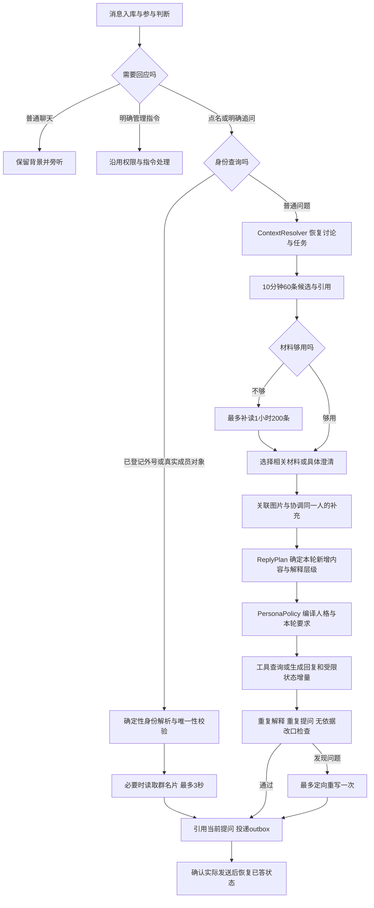

# 会仙回复与群聊链路

核心规则：先听懂，再接话。默认直接回应、给判断或接梗，用户追问后再解释；篇幅由本轮新增内容决定。



## 路由与材料

- v4.1.1 在语境模型之前识别身份问句。`parseMemberIdentityQuery` / `resolveMemberIdentityQuery` 统一处理“某某是谁”“谁是某某”“认识某某吗”“我是谁”及身份核对；精确保存的别名和真实 @／同群引用才能确定身份，不使用普通文本数字或模型猜测授权。
- 自我查询按实际发言账号处理；外号重名、引用对象与别名冲突时只澄清一次。未知且未限定群成员的人名仍走普通问答，短别名不匹配较长姓名。名片读取仅在必要时发起，整个刷新最多 3 秒，失败保留已确认映射。
- 身份解析不读取画像或个人历史，不赋予角色称呼任何管理权限。回复沿原 outbox 事务与回执投递，同一来源的并发查询串行检查已有回复，重试与重启复用已发布投递。

- `BotApplication.prepareConversationRoute` 在 worker 入队前完成解析，legacy 入口使用同一方法。解析结果按来源消息保存，重试复用决定。
- 明确引用优先；可读引用原文与该讨论的必要近期背景。同一成员可返回旧话题；其他成员加入讨论时共享话题和选中的公开材料，保留各自分支和任务。
- 语境模型使用辅助模型路由（每次 4 秒、总预算 10 秒），底层独立请求最多 8 秒；输出只允许已有话题和消息 ID。异常或格式错误回退到有界背景与原有路由，不丢弃其他成员和机器人的相关发言。
- 初读候选最多 10 分钟 60 条；解析器判断不足时，只扩读一次到 1 小时 200 条。语义选择最多 24 条，进入最终回复的材料另受 8000 字和单条 500 字预算限制。
- 群上下文开关、成员排除、撤回、群隔离和来源消息之前的时间边界继续有效。限流阻止自动回复，仍允许该条消息作为合规近期背景。
- 默认点名才回应。未再次点名的接话仅接受近期已参与讨论、明确朝会仙发出的追问；普通“所以呢”等群友聊天保持旁听。

## 状态与投递

SQLite migration 21 新增 `conversation_reply_plans`、`conversation_reply_tasks`、`conversation_state_updates`。

- 状态增量保存成员条件与来源、问题是否已回答、已解释内容、判断与材料、图片观察；图片任务另显示排队、处理中、待投递和失败。
- 状态是绑定不可变 assistant turn 的事件，沿当前因果链恢复，版本与 turn 一起保存；不使用一个共享可覆盖对象，旧任务不能覆盖另一分支的状态。
- 状态恢复使用独立的一小时、最多 200 turn 因果链窗口，避免普通回复的 32 turn 原文窗口裁剪后立刻遗忘早先已确认的条件；该窗口原文不会全部加入回复模型。
- 生成可附带 `{text,stateUpdate,review}`，只将 `text` 投递给群员。模型自检与整段重复检查触发至多一次重写；截断的结构化输出不会作为群消息泄漏。
- 只接受来源存在且作者匹配的个人条件；图片观察必须对应本群实际图片。普通聊天不会写入长期记忆。
- 回复与状态增量在发布 outbox 的同一事务中保存。恢复状态只读取已确认发送的气泡；未发出、失败或取消的草稿不会算作已解释。仅部分气泡发送成功时保留实际文字，不采纳整份结构化增量。
- 同一人、同一分支的补充可以替代尚未投递的任务，并取消旧 preparing/pending/可重试 failed 气泡。不同人的问题、独立问题及已经进入 sending/sent 的内容不会被合并抹掉。
- 无引用的“看图说话”仅关联同群同用户、收到消息前 2 分钟内唯一图片；有引用则优先指定图片。图片正在处理时沿用任务并携带图片，不先报告缺图。有多个候选时只澄清具体图片。
- 发送继续使用原有 outbox 认领、重试与回执机制，文本附上对应原提问的 QQ 引用。清空与既有七天原始数据保留策略同时清理短期状态。

## 回复策略与人格编译

`ReplyPolicyService` 接收语境解析和已发送状态，输出 `ReplyPlan`：回应人、来源消息、本轮新增内容、已覆盖内容、已回答问题、解释层级、澄清和工具需求。相同成员已经回答过的同一句澄清不再发送。定向检查和修正提示也由该服务负责，入口最多执行一次重写。

`compilePersonaPolicy` 编译保存的人格：保留管理员自定义内容，去掉已知旧版本的受管理段落，将同一套会仙对话规则注入一次。公共层只保留通用聊天、格式和准确性要求；本轮计划只说明当前任务，投递上限只说明传输边界。日常直接、有趣、有判断，用户明确要求长文时完成正文，不因为普通风险关键词进入长回复。

入口 `BotApplication` 串联语境、策略、工具、生成和投递；模型适配层负责请求及结构化结果解析；任务仓库负责版本、取消和回执。普通聊天状态继续与长期记忆分开。

## 输出 Token 预算

- 未设置上限的回复模型统一使用 32,768 token，包含环境默认模型、流式、非流式、工具后的最终回复和定向重写。既有显式上限继续生效；例如已有 8192 配置不会被覆盖。当前线上选择的 `sol` 未设置上限，部署此版本后继承新默认值。
- 后台配置和运行时范围为 64～65,536 token；正文、状态增量和检查结果共享配置额度，不再依赖提示词字符串匹配额外追加 1024 token。静态 HTML 的独立默认预算继续由其专用设置决定。
- 额度是最大输出空间，不是篇幅目标。日常仍按新增信息接话；明确要求详细时展开，投递层仍执行该任务对应的字符和气泡边界。
- 流式、非流式与工具请求均检查 `length`、`max_tokens`、`max_output_tokens`。截断结果即使看起来是合法 JSON 也不会投递、执行部分工具调用或保存状态；允许按现有路由尝试已配置的备用模型。
- 上游拒绝配置额度时保留明确失败原因，沿既有错误处理返回，不偷偷降回旧的 600 token。日志只记录决策摘要及错误信息，不输出内部推理。

## 人格迁移与验证

`assets/huixian-profile.json` 是更新后的基线。既有 SQLite 人格由部署迁移脚本中的 `upgradeHuixianConversationProfileOnce` 独立升级，标记为 `conversation-policy-2026-10-20-r2`；已应用 `conversation-delta-2026-10-20` 的数据库也可升级。

迁移前在 `v3_character_profile_revisions` 保存完整旧人格快照，标记 `snapshot:before:conversation-policy-2026-10-20-r2`。迁移保留管理员的名称、模型参数、自定义规则、知识与示例，以及旧策略段落后追加的内容；只更新完全匹配的旧默认文案和两个旧默认追问示例。当前标记或未知更新标记存在时不重新覆盖。回滚时可从该快照恢复人格。

验证包含首次评议、同人切换再返回话题、多人质疑、已知条件与已答问题、解释层级、图片 15 秒补充、旧草稿取消、失败与部分投递、重启恢复、群与分支隔离、上下文关闭与排除成员、人格迁移快照和幂等、规则只注入一次、输出预算一致性及截断拒绝。

```powershell
node scripts/run-node22.cjs scripts/test.cjs
node scripts/run-node22.cjs scripts/visual-admin-smoke.mjs
```

这些回放使用受控模型输出验证编排与投递，不代替真实模型在群里的语言质量验收。v4.1.0 已整合 v4.0.0 的运行时与安全措施；部署迁移会升级保存的人格并保留完整快照。上线后应先在一个指定群观察首次接话、重复率、改口依据和响应延迟。
